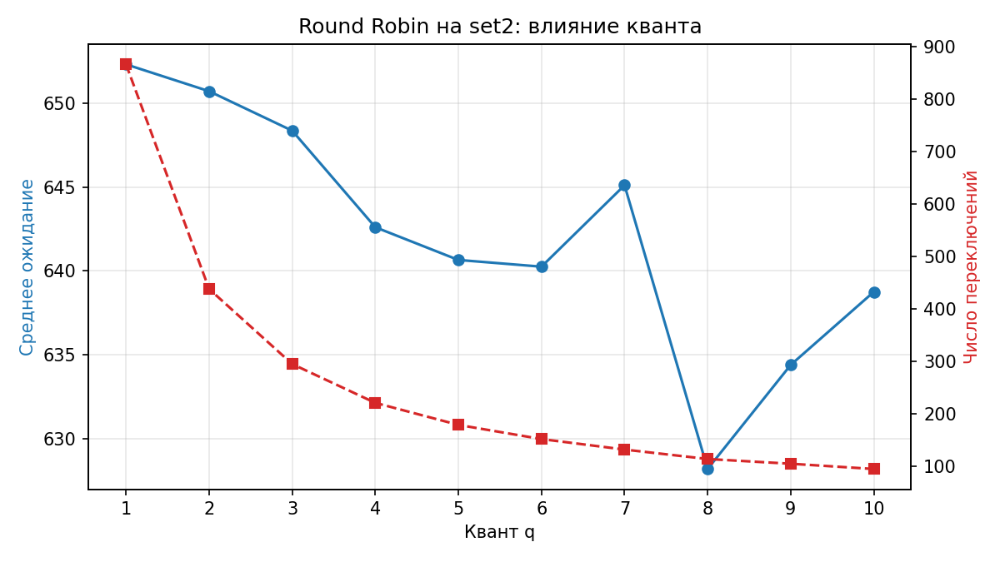

# Практическая работа № 5. Симулятор планирования CPU (вариант B)

## Запуск
```
python3 sched.py --algo rr --quantum 3 set1.txt
python3 sched.py --algo all --quantum 3 set2.txt
python3 sched.py --algo priority --aging 2 set_starve.txt
python3 rr_plot.py
```
Алгоритмы: `fcfs`, `sjf`, `srtf`, `priority` (вытесняющий, меньше число = выше приоритет), `rr`.
Единая функция `simulate(processes, algorithm, **params)` возвращает список интервалов
`Interval(pid, start, end)` (`pid=None` означает простой CPU). Метрики считаются отдельно по этому списку.

## Файлы
- `sched.py` — симулятор и метрики
- `gen_sets.py` — генерация наборов set2, set3 и set_starve (seed=7)
- `rr_plot.py`, `rr_plot.png` — график зависимости от кванта для RR
- `set1.txt`, `set2.txt`, `set3.txt`, `set_starve.txt` — входные данные
- `out_*.txt` — сохранённый вывод запусков

## Определения метрик
- оборот = завершение − прибытие
- ожидание = оборот − burst
- отклик = первый запуск − прибытие
- загрузка CPU = занятое время / длина всего периода
- переключения = число смен процесса на CPU между соседними интервалами

## Наборы данных
- set1.txt: контрольный (4 процесса; приоритеты P1=2, P2=1, P3=3, P4=2 добавлены мной, в условии их нет)
- set2.txt: 20 CPU-bound процессов, burst 20..60
- set3.txt: 19 коротких процессов (burst 1..6) и один длинный P1 (burst 100)
- set_starve.txt: P1 с приоритетом 9 и поток из 20 коротких процессов с приоритетом 1
  (новый приходит каждые 3 такта)

## 1. Сверка с эталоном на set1
| Алгоритм | Ожидание | Оборот | Отклик | Эталон |
|---|---|---|---|---|
| FCFS | 8.75 | 15.25 | 8.75 | в задании 9.25 / 15.75, см. ниже |
| SJF | 7.75 | 14.25 | 7.75 | нет |
| SRTF | 6.50 | 13.00 | 4.25 | 6.5 / 13.0, совпало |
| Priority | 7.00 | 13.50 | 6.00 | нет |
| RR (q=3) | 13.50 | 20.00 | 3.00 | 13.5 / 20.0, совпало |

Диаграмма Ганта RR (q=3):
```
[0-3:P1] [3-6:P2] [6-9:P3] [9-12:P4] [12-15:P1] [15-16:P2] [16-19:P3] [19-21:P4] [21-23:P1] [23-26:P3]
```
Диаграмма Ганта SRTF:
```
[0-1:P1] [1-5:P2] [5-10:P4] [10-17:P1] [17-26:P3]
```
SRTF и RR совпали с эталоном, значит, соглашение об очереди в RR реализовано верно:
процесс, пришедший в момент окончания кванта, ставится в очередь раньше вытесненного.
В SRTF вытеснение проверяется на каждом такте (P1 вытеснен процессом P2 в момент 1).

**Расхождение по FCFS.** Ручной расчёт: P1 работает 0–8, P2 8–12, P3 12–21, P4 21–26.
Ожидание: 0, 7, 10, 18, среднее 35/4 = 8.75. Оборот: 8, 11, 19, 23, среднее 61/4 = 15.25.
Значения 9.25 и 15.75 из задания не получаются при этих данных: у FCFS нет вариантов очереди,
которые могли бы дать другой результат при порядке по прибытию. Считаю эти числа опечаткой в эталоне.

## 2. Сравнение алгоритмов
### set2 (CPU-bound), q=3
| Алгоритм | Ожидание | Оборот | Отклик | Загрузка CPU, % | Переключений |
|---|---|---|---|---|---|
| FCFS | 378.60 | 421.95 | 378.60 | 100.0 | 19 |
| SJF | 326.70 | 370.05 | 326.70 | 100.0 | 19 |
| SRTF | 326.70 | 370.05 | 326.70 | 100.0 | 19 |
| Priority | 409.15 | 452.50 | 404.20 | 100.0 | 20 |
| RR (q=3) | 648.35 | 691.70 | 27.00 | 100.0 | 295 |

### set3 (короткие бёрсты и один длинный), q=3
| Алгоритм | Ожидание | Оборот | Отклик | Загрузка CPU, % | Переключений |
|---|---|---|---|---|---|
| FCFS | 103.35 | 111.85 | 103.35 | 100.0 | 19 |
| SJF | 97.45 | 105.95 | 97.45 | 100.0 | 19 |
| SRTF | 11.05 | 19.55 | 7.55 | 100.0 | 20 |
| Priority | 72.55 | 81.05 | 71.75 | 100.0 | 25 |
| RR (q=3) | 28.00 | 36.50 | 13.10 | 100.0 | 36 |

**Наблюдения.**
- На set3 FCFS страдает от «эффекта конвоя»: короткие процессы ждут за длинным P1
  (ожидание 103.35 против 11.05 у SRTF).
- SRTF даёт минимальное среднее ожидание, но требует знать длину бёрста заранее.
- RR на set2 хуже остальных по ожиданию (все процессы однотипные и долгие), но лучше по отклику
  (27 против 378 у FCFS).
- Загрузка CPU везде 100 %: простоев нет, потому что процессы приходят плотно.

## 3. RR: квант и компромисс (set2)


| q | Ср. ожидание | Переключений |
|---|---|---|
| 1 | 652.30 | 866 |
| 2 | 650.70 | 438 |
| 3 | 648.35 | 295 |
| 4 | 642.60 | 221 |
| 5 | 640.65 | 179 |
| 6 | 640.25 | 152 |
| 7 | 645.10 | 132 |
| 8 | 628.20 | 114 |
| 9 | 634.40 | 105 |
| 10 | 638.75 | 95 |

**Компромисс.** Число переключений падает почти обратно пропорционально кванту
(866 при q=1, 95 при q=10). Среднее ожидание на этом наборе меняется слабо (628–652):
процессы CPU-bound и приходят почти одновременно, поэтому суммарная работа,
которую нужно выполнить до завершения каждого, мало зависит от кванта.
Малый квант улучшает отклик, но стоит много переключений контекста
(в симуляторе их цена не учтена, на реальной ОС это накладные расходы).
Большой квант сокращает переключения, но RR приближается к FCFS и отклик ухудшается.

## 4. Голодание и старение (приоритетное планирование)
Набор set_starve.txt: P1 (burst 5, приоритет 9) и поток коротких процессов с приоритетом 1.

Без старения P1 завершается последним, на 85-м такте, ожидание 80:
```
... [77-81:P21] [81-85:P1]
```
Со старением aging=2 (каждые 2 такта ожидания приоритет повышается на 1) P1 получает процессор
уже в моменты 21–22 и 26–29 и завершается на 29-м такте, ожидание 24:
```
[0-1:P1] [1-5:P2] [5-9:P3] [9-13:P4] [13-17:P5] [17-21:P6] [21-22:P1] [22-26:P7] [26-29:P1] [29-33:P8] ...
```

| aging N | Ожидание P1 |
|---|---|
| выкл. | 80 |
| 5 | 60 |
| 3 | 40 |
| 2 | 24 |
| 1 | 14 |

Старение предотвращает голодание: чем меньше N, тем быстрее P1 получает процессор.
Цена: процессы с исходно высоким приоритетом начинают ждать дольше
(например, P21 ждёт 19 тактов без старения и 23 при aging=2).

## Выводы
- SRTF оптимален по среднему ожиданию, но нужен прогноз длины бёрста и он вытесняет часто.
- FCFS прост, но страдает от эффекта конвоя на смеси длинных и коротких задач.
- RR даёт хороший отклик и справедливость; выбор кванта — компромисс между откликом и переключениями.
- Приоритетное планирование без старения может бесконечно откладывать низкоприоритетные процессы.
